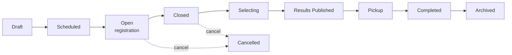
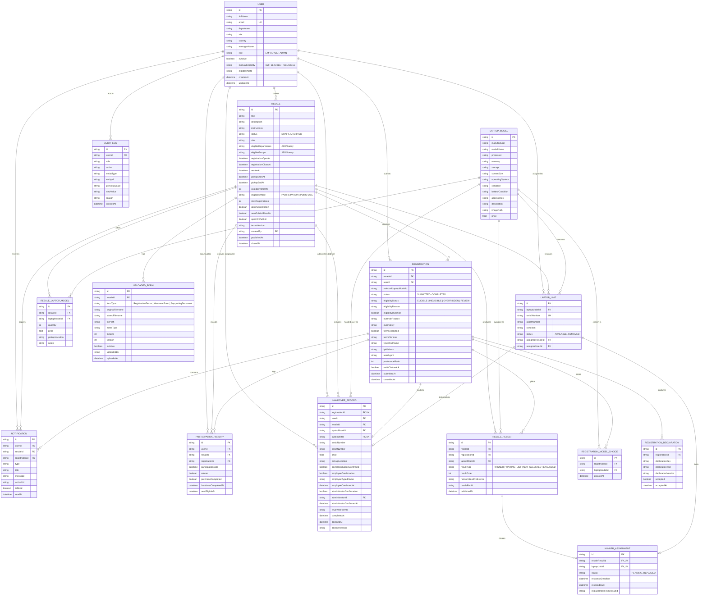

# Laptop Resale — Project Summary & Data Model (ERD)

**Prepared for:** Management review & approval
**Application:** Laptop Resale
**Status:** Functional prototype (production-ready architecture)
**Repository:** https://github.com/Rongel92/Ballot-Site (private)

---

## 1. Executive summary

The Laptop Resale is an internal web application that lets the company
fairly and transparently distribute refurbished company laptops to employees.
Employees register their interest during an open window and accept the required
declarations; administrators create the resale, run a **deterministic, auditable
random selection**, publish results, and manage the physical handover of each device —
all backed by a persistent database and a complete audit trail.

The system replaces manual, spreadsheet-driven processes with a controlled,
policy-enforcing workflow that is defensible from a fairness, compliance, and
record-keeping standpoint.

### Business value
- **Fairness & transparency** — cryptographically seeded, reproducible resale that
  can be independently re-verified.
- **Policy enforcement** — automatic eligibility checks (participation / purchase
  cooldown) prevent the same employees winning repeatedly.
- **Full auditability** — every state change is recorded in an immutable audit log.
- **Reduced admin effort** — automated lifecycle, waiting-list promotion, Excel
  exports, and electronic handover confirmations.
- **Compliance-ready** — electronic signatures, declaration capture, and payroll
  deduction acknowledgement are all stored per registration.

---

## 2. Key capabilities

| Area | Capability |
| --- | --- |
| Resale lifecycle | Draft → Scheduled → Open → Closed → Selecting → Results Published → Pickup → Completed |
| Employee experience | Guided registration wizard, mandatory declarations, typed electronic signature, model preferences |
| Eligibility | Automatic evaluation (participation / purchase cooldown) with documented admin override |
| The resale | Deterministic, reproducible, auditable — cryptographically seeded per laptop model |
| Waiting lists | Automatic promotion when a winner declines |
| Handover | Dual electronic confirmation (employee + administrator) with payroll acknowledgement |
| Records | Participation history, notifications, and a complete audit log |
| Reporting | Excel (XLSX) exports for registrations, results, inventory, handovers, participation, audit, and a full report |

---

## 3. Technology & architecture

| Layer | Technology |
| --- | --- |
| Frontend | React + TypeScript, Vite, Tailwind CSS, React Router |
| Backend | Node.js + Express (TypeScript) |
| Database | Prisma ORM over SQLite (portable to SQL Server / PostgreSQL) |
| Authentication | Demo sign-in (pick a user from the database) — signed session cookie |
| File storage | Local server storage (swappable for SharePoint / Blob) |
| Reporting | XLSX export via ExcelJS |

All business data lives in the relational database. The architecture isolates the
three items that would change for production — **authentication, file storage, and
the database provider** — behind clean abstractions, so moving to enterprise SSO,
SharePoint, and SQL Server is a configuration/provider change rather than a rewrite.

### User roles
- **Employee** — browses open resales, registers, accepts declarations, confirms handover.
- **Administrator** — manages inventory and eligibility, runs resales, publishes results,
  administers handovers, and reviews the audit log.

---

## 4. Resale lifecycle

---

## 5. Entity Relationship Diagram (full)

> Legend: **PK** primary key · **FK** foreign key · **UK** unique constraint.
> `||--o{` = one-to-many · `||--o|` = one-to-(zero/one). Timestamps
> (`createdAt` / `updatedAt`) exist on most tables and are omitted where not
> essential for clarity.

---

## 6. Entity reference

| Entity | Purpose |
| --- | --- |
| **User** | Employees and administrators; holds eligibility overrides and role. |
| **Resale** | A laptop resale event and its full policy configuration and lifecycle state. |
| **LaptopModel** | A catalogue laptop type (specs, price, image). |
| **ResaleLaptopModel** | Which models — and how many units — are offered in a given resale. |
| **LaptopUnit** | An individual physical laptop (serial/asset) with inventory status. |
| **Registration** | An employee's entry into a resale, with declarations and signature. |
| **RegistrationModelChoice** | The employee's ranked model preferences for a registration. |
| **RegistrationDeclaration** | Each declaration text/version the employee accepted (evidence). |
| **ResaleResult** | Outcome per registration (winner / waiting list / not selected / excluded). |
| **WinnerAssignment** | Links a winning result to a specific physical unit and tracks the accept/decline response. |
| **HandoverRecord** | The physical handover with dual electronic confirmation and payroll acknowledgement. |
| **UploadedForm** | Versioned supporting documents / terms / handover forms. |
| **Notification** | In-app messages to users about resale and registration events. |
| **ParticipationHistory** | Per-user participation ledger used to compute cooldown eligibility. |
| **AuditLog** | Immutable record of every significant action for compliance. |

---

## 7. Security, compliance & data integrity

- **Auditability** — `AuditLog` captures actor, action, before/after values, and
  reason for every significant change.
- **Fair resale** — results are produced from a recorded random seed
  (`randomSeedReference` / `resaleRunId`), making each resale reproducible and verifiable.
- **Consent & signatures** — declarations and a typed electronic signature are stored
  per registration (`RegistrationDeclaration`, `typedFullName`, `ipAddress`, `userAgent`).
- **Referential integrity** — foreign keys with cascade rules keep child records
  consistent; unique constraints prevent duplicate registrations and double-assigned units.
- **Least privilege** — role-based separation between Employee and Administrator actions.

---

## 8. Production readiness & integration points

The system is deliberately built so the three enterprise concerns are swappable
without redesigning the application:

- **Authentication** → demo sign-in: pick any active user from the database; roles come from the user record.
- **Database** → switch the Prisma provider from SQLite to **SQL Server / PostgreSQL**.
- **File storage** → swap local disk for **SharePoint / Azure Blob**.
- **Notifications** → the notification service is ready for **Email / Teams** channels.

---

## 9. Approval

| Item | Detail |
| --- | --- |
| Requested decision | Approval to proceed to production hardening (SSO, enterprise DB, hosting) |
| Prepared by | _(your name)_ |
| Date | 2026-08-24 |
| Reviewed / approved by | ____________________________ |
| Signature | ____________________________ |
